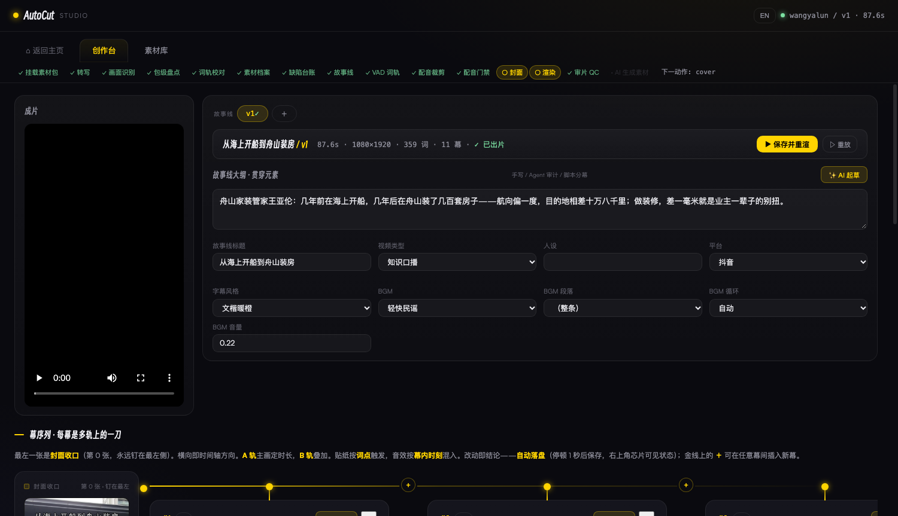
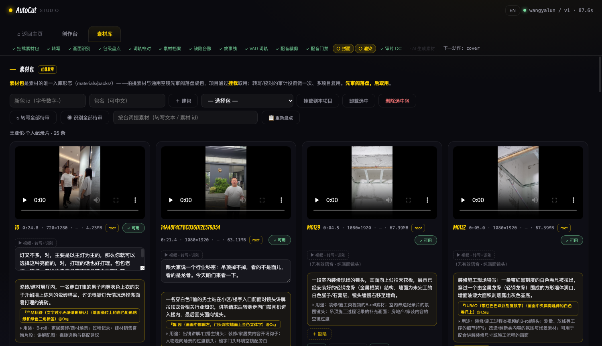

# auto-cut v3 · Automated Talking-Head Short-Video Pipeline

[中文](README.md)

[](https://github.com/noah-1106/auto-cut-v3/actions/workflows/ci.yml)
[](LICENSE)
[](https://www.python.org)
[](.)
[](.)
[](https://ffmpeg.org)
[](https://www.minimaxi.com)

**In one sentence**: turn a batch of phone-shot footage into a vertical talking-head short video with karaoke subtitles, BGM, and transitions — automatically. Humans (browser Studio) and agents (CLI/HTTP) operate with equal rights; everything passes through files, and every node can fail independently.

## Core idea: a "beat"-based video workbench

Traditional editors (CapCut / Premiere) are a **horizontal timeline × N tracks** — you scrub back and forth: syncing, aligning, hunting for cut points, and one change ripples everywhere. auto-cut uses a different abstraction: **a finished video is a column of "beats"; each beat = one vertical slice across all tracks in the same time window** — A/B video, narration, subtitles, transitions, stickers, SFX, music, all edited inside that beat's card. Time flows horizontally along the beat sequence; the ＋ on the gold line inserts a new beat anywhere.

This abstraction buys three things:

1. **Agent-editable** — the LLM drafts and modifies a structured beat-sequence JSON, not a timeline project file; every beat renders its own low-res proof in seconds, so "the film passed" ≠ "each beat passed" — verified beat by beat
2. **Human-reviewable** — the Creator view shows a column of cards saying "what this video says", not a wall of waveforms; click any beat for an instant preview, edits autosave 1.2s after you pause
3. **Pipeline-automatable** — a 15-step orchestrator (mount → transcribe → identify → digest → proofread → dossier → defect log → draft → VAD word track → dub fit → dub gate → cover → render → QC → reserved aigen) runs the whole chain; a fresh pack of materials cold-starts to a finished cut with zero in-session human rescue

**Design philosophy**: the agent goes fully automatic from raw footage to final cut; the human is the rule-setter (config thresholds/strategies) and final-cut reviewer — never a bottleneck inside the pipeline.

---

## UI at a glance

**Home**: create projects, manage effect registries, jump into the Creator from project cards.


**Creator**: pipeline progress bar on top (15 nodes with live ✓/○/✗/· status, same source as the orchestrator) | final-cut monitor | storyline outline and global settings (subtitle style/BGM/segment/cover) | the beat-sequence gold line (horizontal = timeline; ＋ inserts a beat; click a beat for a quick low-res proof).


**Library**: material packs mounted into the project (the only way materials enter) plus project cuts; proofread transcripts in place; material cards carry review badges (✓ usable / ◌ pending / ✕ reject) and a defect log.


---

## Quick start

### 0. Prerequisites (one-time)
```bash
# ffmpeg 6.0+: put it at bin/ffmpeg (mac) or bin/ffmpeg.exe (Windows), or in PATH (libass/libx264 builds required)
bin/ffmpeg -version        # verify (Windows: bin\ffmpeg.exe -version)
```

**Cloud service keys** (fill `config/services.json`, gitignored forever; `api_key_env` points at an env var you export, or `api_key_file` at a `{"api_key":"..."}` file). What each section does:

| services.json section | Purpose | Required? | Default provider | Key-free alternative |
|---|---|---|---|---|
| `asr` | Speech transcription (word-track material) | **Yes** | minimax | `local-faster-whisper` (local, no key) |
| `vision` | Frame identification (material understanding/defects) | **Yes for video** (without a key, video never passes review and draft drops it; humans can force-pass on the material card) | minimax | none |
| `llm` | AI storyline drafting + proofreading | **Yes** | minimax | none |
| `tts` | dub voice synthesis | only for dub beats | local-audio8 (this repo's configured default, no key, see 0.5) | unneeded if all beats are original-audio |
| `image` | AI cover generation | optional (covers can also be frame grabs / output frames / uploads) | minimax | five routes: first-frame/beat-frame/ai-generated(base+prompt)/output-frame/upload |
| `video` | AI-generated video material | optional (rarely used) | minimax | all-shot footage is fine |

Minimal viable combo = ffmpeg + the three keys asr/vision/llm, running the full chain with original-audio narration.
Platforms: macOS and Windows (Python 3.10+, zero pip dependencies; the local-TTS onnxruntime venv is an optional component, see "Local TTS" below).

### 0.5 Local TTS (Audio8-TTS, optional component)

The default dubbing provider is local [Audio8-TTS-Preview-0.6B](https://huggingface.co/Audio8/Audio8-TTS-Preview-0.6B-ONNX-INT4) (Apache 2.0, ONNX INT4 CPU inference, ~1GB RAM) — note: **this is this repo's services.json configured default, not the code default** (tts.py `_provider()` falls back to `"minimax"`; a fresh clone must explicitly set `"provider": "local-audio8"` in the services.json `tts` section). The zero-pip core pipeline is unaffected; the runtime lives separately in `~/.local/share/autocut3/audio8/` (venv + model weights), the adapter `autocut3/tts_audio8.py` talks only over HTTP (127.0.0.1:8024), and the service self-starts on demand. **Idle auto-exit** (2026-09-19): self-started instances carry a watchdog `tts_idlekill.py` — successful synth/register refreshes a `last-use` marker; after **60 idle minutes** (tunable via `ARKTTS_IDLE_S`) the service shuts itself down and restarts transparently on next call; manually launched `run_server.sh` instances are outside the watchdog's scope.

```bash
# One-time install (~1GB model; the script falls back to hf-mirror when HF is blocked):
#   git clone Audio8_TTS into ~/.local/share/autocut3/audio8/runtime,
#   python3.12 -m venv ~/.local/share/autocut3/audio8/venv,
#   pip install -r onnx_runtime/requirements.txt + tokenizers (unmarked upstream),
#   download all *.onnx(.data) from the ONNX-INT4 repo into ~/.local/share/autocut3/audio8/model
python3 autocut3/tts_audio8.py status                    # runtime/service/voices three-state check
# Register a reference voice (zero-shot cloning hard contract: 0.5-30s reference audio + word-for-word transcript)
python3 autocut3/tts_audio8.py register <name> <reference.wav> "<transcript>"
python3 autocut3/tts.py synth --text "..." --out x.mp3   # provider=local-audio8 goes local
```
Back to cloud: set `tts.provider` in config/services.json back to `"minimax"`.

### 1. Start Studio (human side)
```bash
python3 studio.py                 # http://127.0.0.1:8765
```

### 2. Run the whole chain (agent side, equivalent to the above)
```bash
# ① Create a pack + upload footage (Chinese filenames OK; M-numbers auto-extracted as ids)
curl -X POST localhost:8765/api/pack-create/ -d '{"id":"mypack","name":"My footage"}' -H 'Content-Type: application/json'
curl -X POST "localhost:8765/api/pack-upload/mypack?filename=20260827_M0211.MP4" --data-binary @footage.MP4

# ② Create a project + mount
curl -X POST localhost:8765/api/project-create/ -d '{"name":"myproj","title":"My project","format":"vertical"}' -H 'Content-Type: application/json'
curl -X POST localhost:8765/api/pack-mount/myproj/mypack/mount

# ③ Material-level pipeline: transcribe + identify in one pass (each clip's ASR immediately chains
#    into its vision pass, 3+3 dual-pool concurrency; step-by-step/single-clip retries: transcribe.py / understand.py)
python3 autocut3/process.py myproj

# ④ AI-draft a storyline (reads the dossier, writes storylines/aidraft.json)
curl -X POST localhost:8765/api/draft/myproj -d '{"intent":"gadget unboxing narration"}' -H 'Content-Type: application/json'

# ⑤ Render the final cut
curl -X POST "localhost:8765/api/render-start/myproj?story=aidraft"
# Output: projects/myproj/out-aidraft.mp4 + subtitle-aidraft.ass + qc-report.json
```

---

## Pipeline map (system overview)

| # | Stage | Module | Artifact | Consumed by |
|---|---|---|---|---|
| 1 | Transcribe | process.py (pipeline: each clip's ASR immediately chains into vision, dual-pool 3+3) | pack.json (word track + text + visual) | draft / word track |
| 2 | Understand | done in the same process.py pass (understand.py for fallback retries) | digest (scenes/assets/roles) | draft |
| 3 | Defect log | disposition.py | disposition.json (four defect classes + suggested windows) | draft prompt / material card ⚠ |
| 4 | Draft | draft.py | storylines/*.json | render |
| 5 | Dub fit | dubfit.py | dub audio + verification report | render |
| 6 | Word track | vadwords.py | per-beat word track (tier=word measured values taken directly, else VAD spreading) | subtitles / karaoke |
| 7 | Cover | pipeline.py (build_cover/cover_check) | cover/cover-*.jpg | render gate / publishing |
| 8 | Render | pipeline.py | out-*.mp4 + subtitle.ass | gates / delivery |
| 9 | Gates | qc (R1-R11) + dubgate + G1/G2t | qc-report + gate reports | delivery verdict |
| 10 | Delivery | loudnorm + release naming | release cut | human final review |

Above is the conceptual 10-stage map; the machine-checkable stage-status source of truth is the orchestrator's `STEPS` in `orchestrate.py` (15 steps — the extra granularity is audit and reserved slots like mount/digest/proofread/dossier/aigen). All automatic. Hardware encoders preferred (mac=videotoolbox / win=nvenc·qsv, fallback libx264); dub fitting runs "envelope locate → trim head/tail → ASR closed loop", and a failing dubgate step halts `--advance` before render; **cover generation + check run BEFORE render** (2026-09-18 ruling: a failed cover exits 1 without burning a render; output-frame is the only post-render strategy = frame from the finished cut). Five strategies: first-frame (default) / beat-frame (beat no. + seconds) / ai-generated (representative frame as base + prompt via image-01 preserving subject; **a base image with a real face is always blocked by platform review (error 1026)** — the only fidelity route for people covers = frame grab + locally composited title_text) / output-frame / upload. Titles are always deterministic local drawtext (AI-drawn CJK = fake glyphs). Covers are normalized to the project format (landscape-shot vertical-crop footage auto-conforms). Standalone cover: `python3 autocut3/pipeline.py cover <proj> <story>`; the Studio "Build cover" button is the same path.

**Pipeline orchestrator**: `autocut3/orchestrate.py` derives every stage's status from files (including the reserved aigen slot) — one entry point for human and agent:
```bash
python3 autocut3/orchestrate.py myproj              # status (✓/○/✗/· + next action)
python3 autocut3/orchestrate.py myproj --advance    # advance to the next gate (material stages fully automatic; the storyline gate is either --intent AI draft or a hand-written storylines/*.json — both pass on landing; mounting is a creative-decision gate)
```
The Studio progress bar shares its source with `/api/status/<proj>` — as the agent advances, the human always sees it.

**Human-machine contract**: defect handling is a technical repair decision (quantified criteria: dup fingerprints / energy envelopes / silence thresholds); the agent executes fully automatically by the rules and leaves a trail — **no prior human confirmation**; the human holds rule-making power (config) and final-cut review (optional).

---

## Registries (effect system)

registry/*.json is the single source of truth for "which effect to use", shared by humans and agents. Management entry: effect cards on the home page → management drawer (listen / view images / subtitle proofs / add-edit-delete / import).
The drafting agent reads the same registries to pick BGM/transitions/**subtitle styles/stickers/SFX** (all injected into the draft prompt; the LLM picks per beat semantics; validate whitelists pass them through); subtitle styles, stickers, and SFX are referenced by id. Stickers are **text templates** (2026-09-18, v1 rule restored): the registry stores only the visual style (yellow note / red warning / gold tip…), phrases are distilled by draft from the beat's narration (≤6 chars hard gate), and drawtext paints them at render time (cached) — text follows content, not images. **Change the registry and the next render changes; no code edits.** The 2026-09-18 "modern & lively" batch (7 styles after two review rounds: dopamine four-color capsules / white-ring candy-red & ink-black / comic pop) uses v2 render primitives (`font`=wenkai/smiley/kuaile, `radius` up to capsule, `shadow`+`shadow_c` hard drop shadow, `ring`+`ring_c` white edge ring): tight-cropped canvas, overlay height locked to sticker_h with width adapting to text (182px for 1 char → 696px for 6 chars, proportional); **geometry is data-driven** — vertical sticker height 220 and top-center y=140 margin live in `registry/formats.json` (`sticker_h`/`sticker_top`; corners still hug the 30px margin) — edit the registry, change the render; the management drawer renders a **real proof** per style (`/api/sticker-preview/<id>` runs the same implementation as the renderer — preview = product).
BGM entries support `segments` (intra-track sections: name/in/out/desc) — both beat-level music and global audio can pick a segment, with a loop flag for segment looping.
SFX is registry-curated (after a 2026-09-18 listening review only a ding and a success sting remain; the rest measured unusable and were delisted; sources and license in `assets/sfx/viral/sources-manifest.json` + `LICENSE-mixkit.txt` — better finds can be registered anytime — a storyline referencing a deleted SFX is skipped at render, no crash).
AI cover images go through image_gen.py (MiniMax image-01, `image` section of services.json); AI video material through video_gen.py.

---

## Directory layout

```
studio.py            # all backend routes (equal-rights HTTP for human/agent)
studio/index.html    # single-page frontend (pipeline bar / registry drawers / live render progress + notifications)
autocut3/            # pipeline modules: orchestrate(orchestrator) process(material pipeline·ingest first choice) asr(provider adapter + word-track normalization)
                     #   transcribe(ASR) understand(vision · incl. pack digest build_digest) vision(vision provider adapter) draft(AI drafting) disposition(defect log)
                     #   pipeline(cover/render) qc(QC R1-R11) proofread(proofreading) vadwords(VAD word track)
                     #   dubfit(dub fitting) dubgate(dub gate) dossier(material dossier) tts(dub synthesis) tts_audio8(local TTS runtime) tts_idlekill(TTS idle watchdog)
                     #   video_meta(geometry probe) flock(cross-platform lock) image_gen(AI cover production dep)/video_gen(AI video reserved) library(v1 cuts legacy layer)
registry/            # registries: single source of truth for the effect system (*.json pure data)
                     #   bgm/subtitles/transitions/sfx/stickers = effects; video_types/platforms = editing-method archives
                     #   (type → draft prompt + render defaults + R11 duration range; platform → loudness anchor — maintainable via Studio drawers); enums/formats = semantic enums (read-only)
assets/              # effect asset files (registry `file` fields point here)
materials/packs/     # user footage store (large files, not in git)
projects/<name>/     # project workspace: storylines/, out-*.mp4 finals, qc-report.json (not in git, .gitkeep placeholder)
config/              # services.json (service keys) lexicon.json (proofread lexicon) qc_rules.json defects-policy.json (v2 disposition rules · design-era material)
docs/                # design docs (pipeline-v2.md = pipeline automation design; archive/ = retired material; README.md = doc map + glossary)
tests/               # e2e.py (end-to-end) rmw_smoke.py (concurrency) audit.py (code auditor) fixtures.py (e2e fixtures) domsim.js (frontend execution-sim template, T64) browser_smoke.html (real-browser smoke harness, T67)
bin/                 # ffmpeg 6.0+ (bring your own, not in git)
```

---

## Run any node standalone

Every module runs alone (input = files, output = files):
```bash
python3 autocut3/transcribe.py myproj --material M0211   # transcribe one clip
python3 autocut3/understand.py  myproj --material M0211   # identify one clip
python3 autocut3/vadwords.py    myproj --story main       # regenerate VAD word track
python3 autocut3/dubfit.py      myproj --story main       # automated dub fitting (dub beats)
python3 autocut3/dubgate.py     myproj --story main       # dub fitting gate
python3 autocut3/proofread.py   myproj --dry              # proofread rehearsal, nothing written
python3 autocut3/pipeline.py    beat myproj 2 main        # single-beat proof (seconds, 540p; for self-check after edits & human review)
python3 tests/e2e.py                                       # full regression (count = the trailing "N passed / M failed" line)
python3 tests/audit.py                                     # code auditor
```

---

## Troubleshooting

| Symptom | Check first |
|---|---|
| Upload Broken pipe / 000 | does materials/packs/<pack>/ exist (auto-created as fallback); is the file >1GiB |
| "bad filename" | filename contains `/` `\` `..` or starts with `.` (Chinese names are allowed) |
| Transcribe 401/timeout | keys in config/services.json; minimax cloud limits ≤50MB/≤500s |
| Render stuck at ffmpeg | the `tail` field of projects/<proj>/render.status holds the last 400 stderr chars |
| Subtitles not paginating/overlapping | was subtitle-*.ass generated; is the words track empty (failed transcription silently drops subtitles) |
| Subtitles offset from speech | word-track source narration.words: transcript tier=word (measured) takes the direct channel; tier=vad/sent — see vad-report spans; for window offsets set narration.window_local (hand-picked window spread over story) |
| Residual noise at dub head | did dubgate run; was the audio head-trimmed (energy-envelope 0.1s-level locating, never trust ASR word times) |
| Code changes not taking effect | **studio.py is a resident process — restart it after edits** (two past "I changed it but nothing happened" incidents were module caching) |

---

## Tests & quality

```bash
python3 tests/e2e.py      # end-to-end (upload/draft/render/concurrency/security); ALL GREEN is the delivery bar
                          # count = the trailing "N passed / M failed" line; --fast skips real-billing LLM/ASR/TTS items — daily regression
python3 tests/audit.py    # nine-dimension audit: route safety / write-race / JS cross-check / data-link integrity / Python hygiene / doc freshness / git hygiene / i18n parity / human-agent equivalence
python3 tests/rmw_smoke.py# read-modify-write concurrency atomicity
```
Every push to main runs the full e2e on GitHub Actions windows-latest + ubuntu-latest (including real cloud LLM/ASR/TTS smoke tests; keys via repository secrets).

---

## Engineering hard rules (distilled from real incidents — read before contributing or letting an agent touch anything; violating = repeating an accident)

1. **Time sources must be measured; synthesized times are forbidden as anchors** (rewritten after the 2026-09-18 correction): tier=word measured word timestamps are the preferred subtitle timing source — MiniMax gets `timestamp_level=word` (asr.py default; measured on ruxuan-02: 30/31 word onsets land inside VAD speech segments ±0.05s — ASR measurement and VAD physics corroborate each other), and vadwords takes them directly without spreading. Character times at tier=sent/vad are intra-sentence/segment **synthesized values** — that was the truth behind the historical "ASR drift 0–3s" (asr.py never sent timestamp_level; the fault was our synthesis, not ASR measurement). Synthesized times are forbidden as cut anchors / window filter anchors: for tier=vad/sent legacy packs the timing source is vadwords.py's VAD physical measurement (silencedetect speech segments), spreading the full text over VAD segments then slicing the window — never filtering windows by word time (incident: filtering by synthesized times ate sentence heads/tails = missing subtitle chars/half sentences, anchored by T44)
2. **Word-track black zones**: on-set calls/mumbles are missed by ASR — detect "energy has speech, word track has no text" and cut them (incident: the call "three-two-one-go" made it into the final cut)
3. **concat must pad**: skipped intervals (silence holes etc.) must be padded with equal-length silence, or later segments shift forward (incident: the tail started 4s early with no BGM)
4. **Serialization fidelity**: the frontend must pass through unknown fields when saving — whitelist rebuilding = silent data loss (incident: hand-made word tracks all lost, subtitles degraded to even spreading)
5. **Dub-fit closed loop**: cut dub audio must be re-checked by dubgate (first word = story first char / last word covers sentence tail / similarity ≥0.9); gate topology = the dubgate step of orchestrate `--advance` halts the advance (render never starts) — `pipeline.py render` itself does not run dubgate; direct CLI renders rely on the human having passed the gate first
6. **Three gate domains**: text (G1 what was said) + timing (G2t when it was said) + hearing (loudness/silence holes) — "text correct" ≠ "timing correct" (incident: 46% of characters misaligned >1s still passed the text gate)
7. **Fix closure**: fixing A exposing B is normal; a fix converges only when gates re-run to all-green; every fix must land a regression anchor in tests/e2e.py — no anchor = not fixed
8. **Cross-platform discipline (Mac/Windows)**: file locks only via `autocut3/flock.py` (POSIX=flock / Windows=msvcrt, never import fcntl directly); ffmpeg resolution via `ffmpeg_path()` (env → bin/ffmpeg(.exe) → PATH, never bare `"bin/ffmpeg"` relative paths); render encoding via `hw_encoder()` (platform probe, software libx264 only as fallback)
9. **Filter-graph embedded paths = relative + unquoted** (proven on Windows CI): ffmpeg 7+'s new parser treats drive-letter colons (`D:`) inside option values as option separators — quoting/escaping/forward-slashes can't save you; only zero special characters inside the value is stable (paths in `-filter_complex` always via `os.path.relpath(p, ROOT)`, subprocess uniformly `cwd=ROOT`; ready-made implementation `pipeline._ass_spec()`; `-i` paths in argv are exempt)
10. **Proofread review gate**: pending groups in review-queue.json = the stage does not advance (orchestrator hard gate) — "proofread" ≠ "reviewed", advancing with pending items = wrong words in the final cut (incident: a wrong word delivered as correct, anchored by T43)
11. **content_type selection gate**: draft validate hard-rejects — voiceover/meta/ambient/broll forbidden as A-track (playing original audio over script-reading footage = summary-tone voiceover exposure), dialogue/talking footage forbidden as B-track (B-track has no audio channel = mute lip-sync); the B-track audio channel is deliberately absent — mute lip-sync is prevented at selection time (anchored by T45)
12. **loudnorm by default**: the mix chain ends with loudnorm=I=-16:TP=-1.5:LRA=11 (platform loudness anchor); storyline `meta.audio.loudnorm` can disable (false) or retarget; disabling means owning the consequences (incident: un-normalized cut at -19.9 LUFS too quiet, anchored by T46)
13. **Cover pre-gate**: build_cover+cover_check before render; failure exits 1 without burning a render (output-frame is the only post-render strategy); covers normalize to the project format; **the only fidelity route for real-face covers = frame-grab strategy + locally composited title_text** — an AI base image with a real face is always blocked by platform review 1026 (2026-09-18 isolation matrix), AI-drawn CJK = fake glyphs always forbidden (anchored by T55)
14. **at_word trigger gate + two-level word matching**: draft validates at_word must exist in the beat's word-track text (A-track transcript window + story) or the sticker is dropped; word_time matches two levels (word-item substring → character sequence), and a miss must warn in the render log — silent 0.4s fallback with zero alert was an incident (agent-proven「低价」「评论区」never matched, anchored by T56)
15. **Transitions eat only reserved margins, never material words** (2026-09-18 ruling): beat boundaries must land in silence — build_plan stretches each non-flash transition by `dt_eff = min(registered dt, tail-side available silence, head-side available silence)`, extending the out-point to word end + dt_eff and backing the in-point by dt_eff (owords/SFX at shift in sync, srcs read segs to prevent bypass); under 0.2s on both sides it degrades to a hard cut. Word heads/tails are structurally immune to xfade/acrossfade — render-time clamping degrades to a pure safety net (`word_drops` should always be empty; non-empty = window data has bleed, fix the source). flash transitions don't overlap audio, none beats are silent — naturally safe, exempt from this rule. Cost: each boundary costs dt_eff over the bare window; under the 90s draft-prompt target the material budget is ≈86-87s (types with a wider duration_range follow their own range (anchored by T59)
16. **Concurrency discipline** (hardened 2026-09-18; multiple agents / dual Studio instances on one machine is the norm): cross-process render mutual exclusion — a fresh (<300s) running `render.status` rejects (pipeline gate + `/api/render-start` disk double-check, equal for CLI/agent/other instance); final cuts / beat previews / sticker / audio caches always tmp(pid)+`os.replace` atomic rename (**ffmpeg picks the container by output extension — tmp files must keep their `.wav`/`.mp4`/`.png` suffix**); `orchestrate --advance` holds a non-blocking project lock `.advance.lock`; e2e fixture names `e2e-fixture-<pid>` are process-unique (parallel e2e runs don't collide; `fixtures.BASE` follows `E2E_BASE`). pack.json writer flocking and storyline atomic writes are the existing chassis (anchored by the RMW smoke test)

---

## Known limits

- Local TTS (Audio8-TTS, Apache 2.0) voices are registered on demand (tts_audio8.py register); existing voices = `ls ~/.local/share/autocut3/audio8/voices/`
- The subtitle/cover/sticker font LXGWWenKai is subsetted to the full GB2312 charset (7,545 glyphs, 24MB→3.3MB, 2026-10-15) — rare GBK-extension characters (喆/𰻝 class) render as tofu; restore the full font from git history if ever needed
- Dubbed cuts are automatically loudnorm two-pass refined to the target loudness after render (default = platform anchor in qc_rules.json; storyline `meta.audio.loudnorm` can disable (false) or set a custom value — same switch as the in-mix single-pass normalization). All-original cuts are untouched (platforms normalize themselves)

## More docs

- **Cutting-agent operations manual: `剪辑Agent操作手册.md`** (six-stage SOP + tool cards + data contracts + registry maintenance + pit list — required reading before an agent acts; Chinese only)
- Pipeline automation design: `docs/pipeline-v2.md` (Chinese)
- Doc map + glossary: `docs/README.md` (Chinese)
- Third-party license for SFX: `assets/sfx/viral/LICENSE-mixkit.txt`

## Contributing

Issues and PRs welcome. Before submitting, run `python3 tests/e2e.py --fast` (offline regression, count per its output) and keep it all green; render-chain changes should be verified on both macOS and Windows (or rely on the CI dual matrix).
